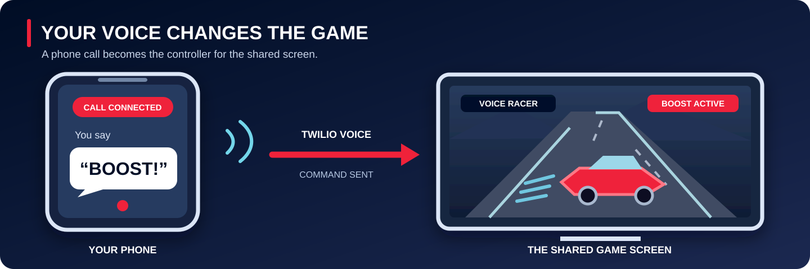
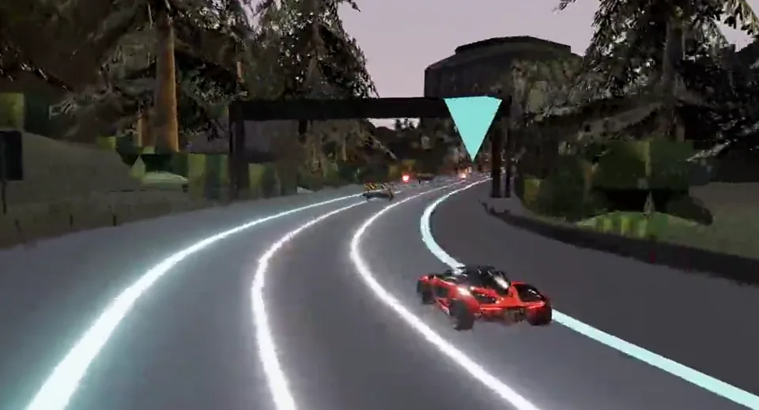
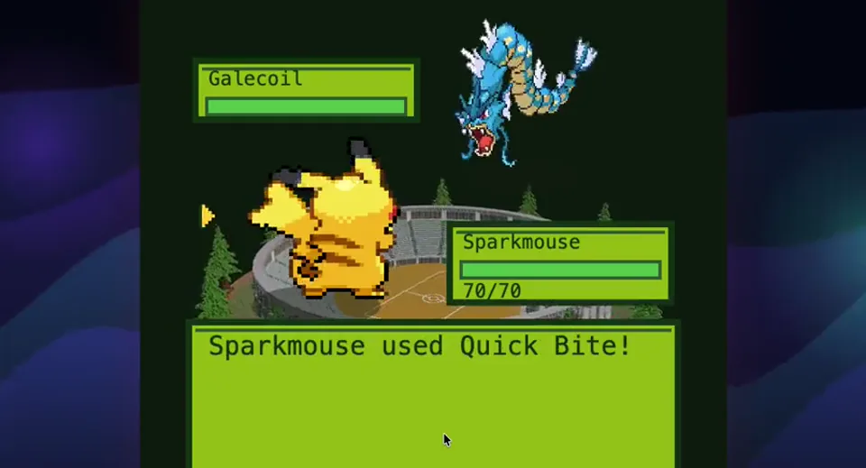
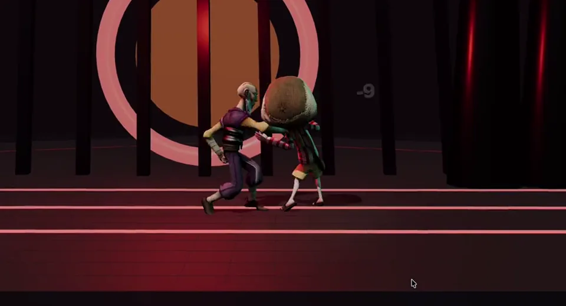
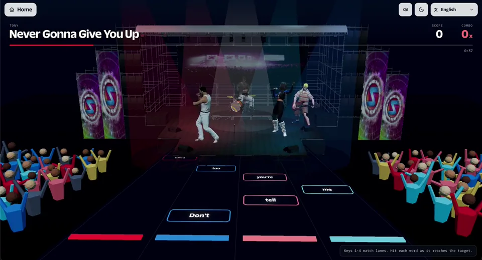
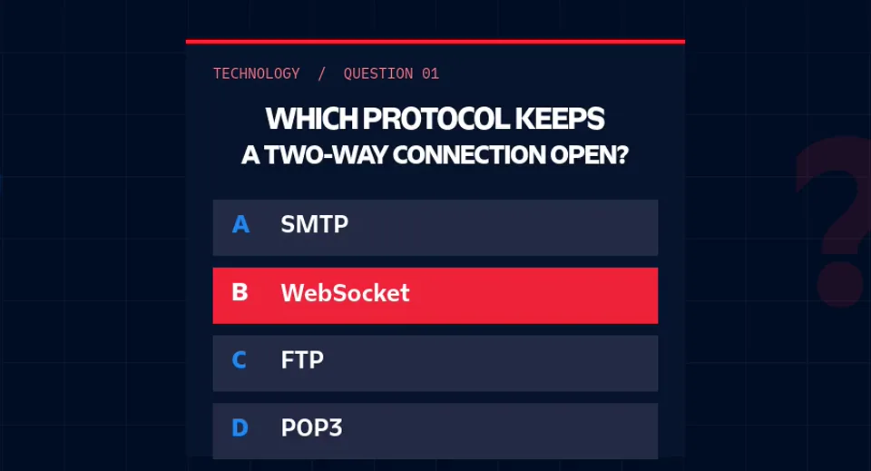
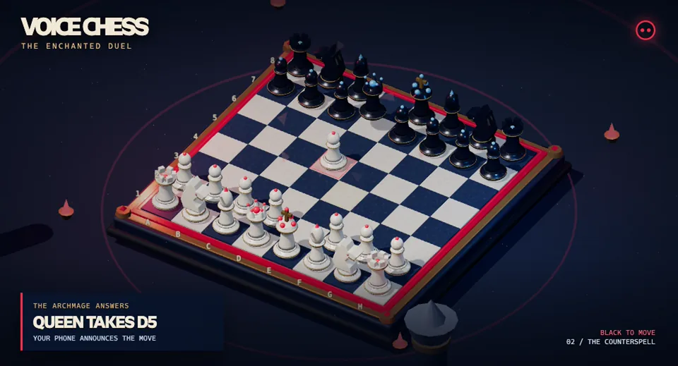
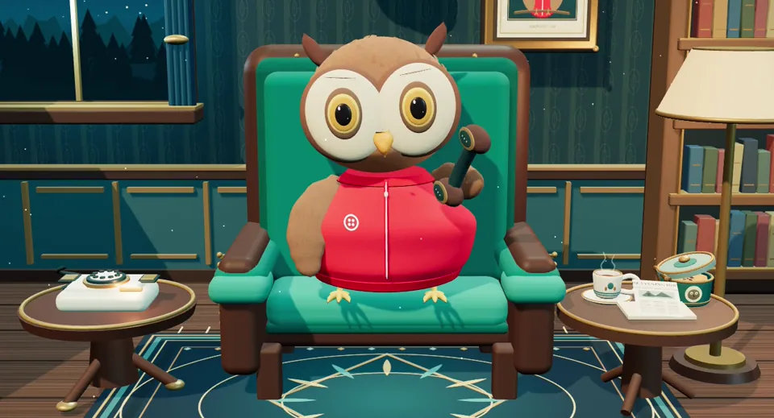
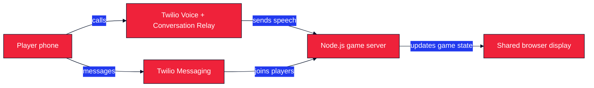

# Twilio Games

<p align="center">
  
</p>

<p align="center"><strong>Call from your phone. Say “boost.” Watch your car accelerate on the shared screen.</strong></p>

<p align="center">
  Twilio Games puts seven voice-controlled games on one shared screen. Call from your own phone; what you say steers a car, launches an attack, moves a chess piece, answers trivia, or changes a scene. No game app or separate controller is needed.
</p>



<p align="center">
  <a href="https://twilio-games.salmontree-f71109fe.centralus.azurecontainerapps.io/">View the arcade</a> ·
  <a href="#games">See all seven games</a> ·
  <a href="#run-locally">Run locally</a>
</p>

<p align="center">
  <a href="https://github.com/anthonyplusAI/twilio-games"></a>
</p>

## Watch the launch film

{{GITHUB_VIDEO_URL}}

*58-second overview pairing captured gameplay with illustrated phone interactions and editorial caller audio.*

## How the arcade works

1. **Join:** At an event, scan the station QR code and join by SMS or WhatsApp where available.
2. **Call:** When admitted, call the number shown on the display or sent to your phone.
3. **Play:** Speak a command, answer a question, or sing a lyric. Your action changes the game on the shared screen, and the phone gives spoken prompts.

The station gathers players, takes votes, and assigns games. In standalone mode, choose a game from the home screen first. The interface supports US English and Brazilian Portuguese.

## Games

Each image is a frame from the game's short gameplay preview. Select one to watch the clip.

<table>
  <tr>
    <td width="50%" valign="top">
      <a href="client/public/video/vr-demo.mp4"></a><br>
      <strong>Voice Racer</strong> · 1–2 players<br>
      Say <code>left</code> or <code>boost</code> → your car steers or accelerates.
    </td>
    <td width="50%" valign="top">
      <a href="client/public/video/vm-demo.mp4"></a><br>
      <strong>Voice Monsters</strong> · 1–2 players<br>
      Say <code>attack</code> or name a move → your creature acts.
    </td>
  </tr>
  <tr>
    <td width="50%" valign="top">
      <a href="client/public/video/vf-demo.mp4"></a><br>
      <strong>Voice Fighter</strong> · 1–2 players<br>
      Say <code>jump</code>, <code>punch</code>, or <code>block</code> → your fighter responds.
    </td>
    <td width="50%" valign="top">
      <a href="client/public/video/vk-demo.mp4"></a><br>
      <strong>Voice Karaoke</strong> · 1 singer<br>
      Sing the words on beat → your timing, lyrics, and pitch shape the score.
    </td>
  </tr>
  <tr>
    <td width="50%" valign="top">
      <a href="client/public/video/vt-demo.mp4"></a><br>
      <strong>Voice Trivia</strong> · 1–4 players<br>
      Say <code>B</code> or the answer → the game records your choice and reveals the result.
    </td>
    <td width="50%" valign="top">
      <a href="client/public/video/vc-demo.mp4"></a><br>
      <strong>Voice Chess</strong> · 1–2 players<br>
      Say <code>pawn from E two to E four</code>, then <code>confirm</code> → the pawn moves.
    </td>
  </tr>
  <tr>
    <td colspan="2" align="center">
      <a href="client/public/video/vo-demo.mp4"></a><br>
      <strong>Talking Owl</strong> · 1 player<br>
      Ask a question → the owl answers. Say <code>mix potions</code> → its lab opens.
    </td>
  </tr>
</table>

## For developers

The browser client uses TypeScript, Vite, and Three.js. A Node.js server owns game state and sends updates to the shared display over WebSockets. Twilio Messaging handles station entry and notices; Twilio Voice and Conversation Relay handle spoken play and talk-back. Voice Karaoke uses Media Streams and Deepgram for production scoring.



Explore the [technical reference](docs/technical-reference.md) for game flows, commands, configuration, testing, and deployment details.

## Run locally

You need Node.js 22.13+, npm 9+, and Git LFS.

```bash
git clone https://github.com/anthonyplusAI/twilio-games.git
cd twilio-games
git lfs install
git lfs pull
npm ci
```

Start the server and client in separate terminals:

```bash
npm run dev:server
```

```bash
npm run dev:client
```

Open [http://localhost:5173](http://localhost:5173). Local previews work without Twilio credentials; live phone calls need a Twilio number and public HTTPS endpoint. Follow the [voice setup guide](docs/voice-setup.md) to connect them.

## Explore the project

| Looking for | Start here |
|---|---|
| Game rules, controls, configuration, and tests | [Technical reference](docs/technical-reference.md) |
| Phone call and Conversation Relay setup | [Voice setup](docs/voice-setup.md) |
| Event station flow and player admission | [Expo Station plan](docs/ARCADE_EXPO_STATION_PLAN.md) |
| Deployment and infrastructure | [Deployment](docs/DEPLOYMENT.md) · [Infrastructure setup](docs/INFRA_SETUP.md) |
| Language support | [Localization](docs/localization.md) |
| Art, music, and model provenance | [Asset credits](assets/CREDITS.md) |

## License

This repository has no project-level `LICENSE` file. Third-party assets have separate terms in [Asset credits](assets/CREDITS.md).
